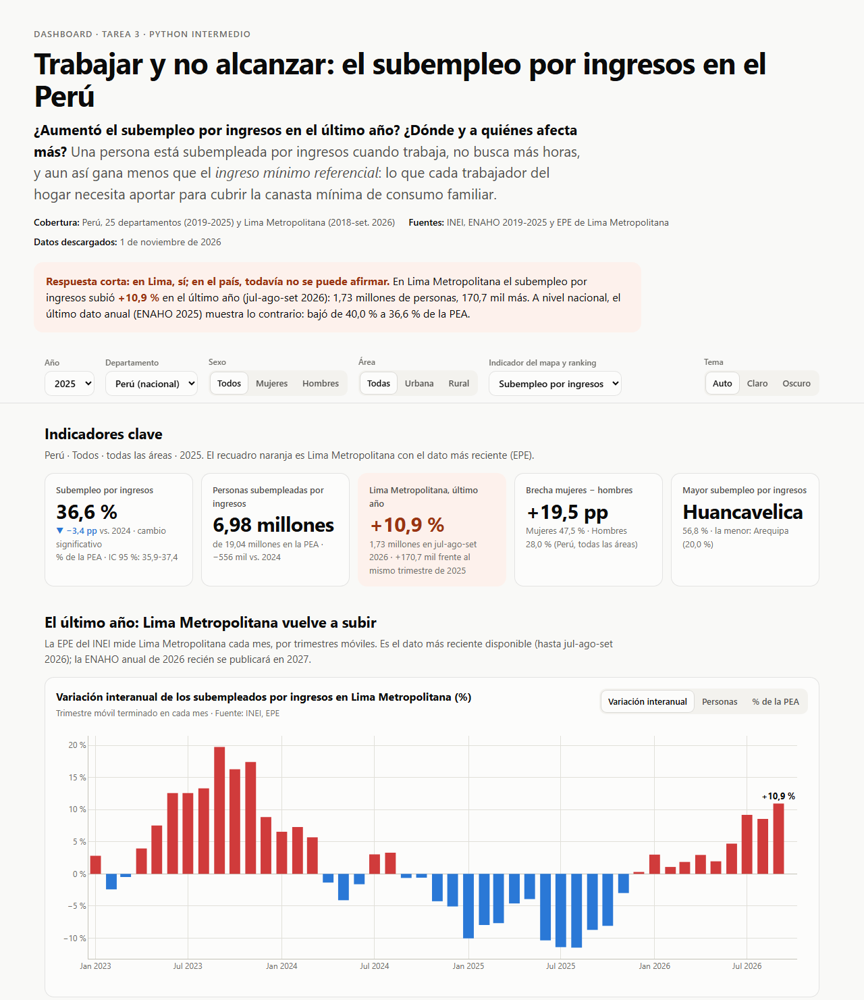
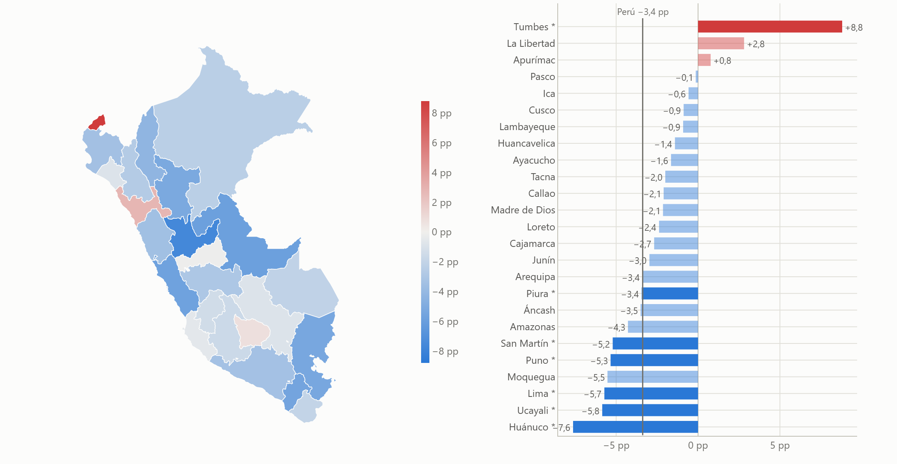

# Tarea 3 · Trabajar y no alcanzar: el subempleo por ingresos en el Perú

**Autora:** Ivette Carolina Mamani Flores · Diplomado en Ciencia de Datos con Python, 2026

| | |
|---|---|
| **Dashboard público** | https://claude.ai/artifact/TfZyyHoNAi8hAm4M7kDpiN (Claude Artifact) |
| **Publicación de LinkedIn** | https://www.linkedin.com/feed/update/urn:li:activity:7522865446153240577/ |
| **Reel** | [`reel/reel.mp4`](reel/reel.mp4) · guion en [`reel/GUION.md`](reel/GUION.md) |

## 1. Tema y pregunta de investigación

**Tema:** el subempleo por ingresos, es decir, las personas que trabajan, no buscan más horas y aun así
ganan menos que el *ingreso mínimo referencial*. Ese ingreso es lo que a cada trabajador del hogar le toca
aportar para cubrir la canasta mínima de consumo familiar.

**Pregunta:** *¿Aumentó el subempleo por ingresos en el último año? ¿Dónde y a quiénes afecta más?*

**Cobertura:** Perú y sus 25 departamentos, de 2019 a 2025 (ENAHO anual), y Lima Metropolitana de 2018 a
setiembre de 2026 (EPE mensual, por trimestres móviles).

## 2. Descripción

El proyecto reconstruye, con los microdatos de la ENAHO, la clasificación del INEI de los ocupados en
empleo adecuado, subempleo por horas y subempleo por ingresos. La valida contra la cifra oficial y la
combina con la serie oficial más reciente de Lima Metropolitana. El resultado son dos productos:

- un **dashboard** con 5 KPIs, mapa, ranking, series y tabla descargable, con 8 controles interactivos;
- un **reel** vertical de unos 60 s con gráficos, mapa, voz generada con IA, subtítulos y música.





## 3. Fuentes de datos y metodología

| Fuente | Qué se usó | Fecha |
|---|---|---|
| INEI, [microdatos de la ENAHO](https://proyectos.inei.gob.pe/microdatos/) | Módulo 05 (empleo e ingresos) y módulo 34 (sumaria), años 2017 y 2019-2025 (códigos 603, 687, 737, 759, 784, 906, 966 y 1031) | Descargados el 1 de noviembre de 2026 |
| INEI, [Series de Empleo Lima Metropolitana](https://www.gob.pe/institucion/inei/informes-publicaciones/3211214-series-de-empleo-lima-metropolitana) (EPE) | Subempleados por ingresos y PEA, por trimestre móvil, hasta jul-ago-set 2026 | Archivo actualizado en octubre de 2026 |
| INEI, [Evolución de los indicadores de empleo e ingresos por departamento 2007-2017](https://www.inei.gob.pe/media/MenuRecursivo/publicaciones_digitales/Est/Lib1537/cap03.pdf) | Cifras oficiales de 2017 para validar el cálculo | — |
| INEI, [Metodología para el cálculo de los niveles de empleo](https://www.inei.gob.pe/media/MenuRecursivo/metodologias/empleo01.pdf) | Definición del IMR | — |
| Límites departamentales (GeoJSON simplificado del curso) | Mapa, unido por código de ubigeo | — |

**Procesamiento** (`scripts/procesar_datos.py`):

1. Se leen solo las columnas necesarias de cada año y se normalizan las llaves (`conglome`, `vivienda`,
   `hogar`) como texto con ceros a la izquierda. No hay duplicados.
2. Se quedan los residentes habituales de 14 años a más que están en la PEA: ocupados y desocupados abiertos
   (`ocu500` = 1 o 2). Son entre 58 869 y 65 991 personas por año, 428 706 en total.
3. **Horas:** las de la semana pasada en todas las ocupaciones. Si no fue una semana normal, se usan las que
   la persona trabaja normalmente.
4. **Ingreso laboral mensual:** monetario, dependiente o independiente, de la ocupación principal y de las
   secundarias (`i524a1`, `i530a`, `i538a1` e `i541a`, divididos entre 12).
5. **IMR:** canasta mínima del hogar (línea de pobreza × miembros) entre el número promedio de ocupados por
   hogar, para cada dominio y área (15 grupos), con los hogares ponderados por `factor07`. Fue de S/ 1 131
   en 2024 y de S/ 1 158 en 2025 en Lima Metropolitana.
6. **Clasificación:** subempleo por horas (menos de 35 horas, quiere trabajar más y está disponible);
   subempleo por ingresos (no está subempleado por horas y gana menos que el IMR); empleo adecuado (el resto).

**Validación con la ENAHO 2017** (`datos/procesados/validacion_2017.txt`):

| Indicador 2017 | INEI | Este cálculo |
|---|---|---|
| PEA (miles) | 17 215,7 | 17 215,7 |
| Ocupados (miles) | 16 511,0 | 16 511,0 |
| Subempleo por horas (miles) | 461,7 | 460,3 |
| Subempleo por ingresos (% de la PEA) | 42,0 | 40,7 |
| … urbano / rural (%) | 33,0 / 73,6 | 32,5 / 69,6 |

**Análisis** (`scripts/analizar_datos.py`): las tasas se ponderan con `fac500a` y se calculan sobre la PEA.
Los errores estándar se estiman por conglomerados, y un cambio se marca como significativo si |z| ≥ 1,96.
Hay dos pruebas de sensibilidad: con solo la ocupación principal y sumando pagos en especie y autoconsumo.
La serie de Lima sale directo del archivo del INEI y cuadra con sus notas de prensa (por ejemplo, +9,2 % y
+145 500 personas en may-jul 2026).

## 4. Hallazgos principales

1. **En Lima, sí aumentó, y con fuerza.** En jul-ago-set 2026 hubo **1 730,5 mil** subempleados por ingresos
   en Lima Metropolitana (27,5 % de la PEA): **+10,9 %** frente al mismo trimestre de 2025 (+170,7 mil). La
   serie lleva 10 trimestres móviles seguidos al alza interanual, después de caer durante todo 2025.
2. **En el país, el último dato anual mostraba lo contrario.** Con la ENAHO, la tasa nacional bajó de
   **40,0 % en 2024 a 36,6 % en 2025** (de 7,53 a 6,98 millones; z = −6,3) y volvió al nivel de 2019
   (37,4 %), tras el pico de 52,5 % en 2020. La caída se mantiene con las otras dos definiciones de ingreso.
   El dato nacional de 2026 todavía no existe.
3. **Tumbes fue la excepción.** Bajó en 22 de 25 departamentos (en 6 con un cambio significativo). Solo
   **Tumbes** subió de forma significativa: de 34,5 % a 43,3 % (+8,8 pp). Huancavelica tiene la tasa más
   alta (56,8 %) y Arequipa la más baja (20,0 %).
4. **Brechas.** En 2025, el 47,5 % de las mujeres de la PEA estaba subempleada por ingresos, frente al
   28,0 % de los hombres. En el área rural la tasa fue 56,0 %, frente a 32,0 % en la urbana.

## 5. Limitaciones

- **Dos encuestas distintas.** El aumento del último año solo se observa en Lima, con la EPE. La ENAHO
  nacional llega hasta 2025. Sus niveles no se comparan directamente: tienen muestras, calendarios y
  métodos distintos.
- **No es la cifra oficial.** El INEI publica la definición del IMR, pero no su cálculo exacto. La réplica
  queda 1,3 puntos por debajo en 2017, sobre todo en el área rural.
- **Error muestral.** Por departamento, el intervalo de confianza es de ±2 a ±4 puntos; los cambios
  pequeños pueden ser ruido. Por eso solo Tumbes se reporta como aumento.
- **Ingresos declarados.** Los independientes reportan su ganancia neta, que suele subdeclararse.
- **2020.** La pandemia obligó a encuestar por teléfono, y ese año no es del todo comparable.

## 6. Enlaces

- Dashboard (Claude Artifact): https://claude.ai/artifact/TfZyyHoNAi8hAm4M7kDpiN · código en [`web/`](web/)
- Repositorio: https://github.com/IvettexMamani/diplomado-python-2026/tree/main/tarea_3
- Publicación de LinkedIn: https://www.linkedin.com/feed/update/urn:li:activity:7522865446153240577/

## 7. Cómo reproducir

```bash
cd tarea_3
uv venv ../.venv --python 3.12            # o python -m venv
uv pip install -r requirements.txt        # en Windows con antivirus que intercepta HTTPS: --system-certs

# 1. Microdatos de la ENAHO (3 GB, no se suben): 2017 para validar y 2019-2025
for a in 2017 2019 2020 2021 2022 2023 2024 2025; do
  python scripts/obtener_datos.py --anio $a --modulos 05 34 --raiz .
done

python scripts/procesar_datos.py          # valida contra 2017 y escribe datos/procesados/pea_2019_2025.parquet
python scripts/analizar_datos.py          # indicadores, CSV y web/data/datos.json
python scripts/graficos_reel.py           # imágenes de las escenas del reel

# Dashboard en local
cd web && python -m http.server 8000      # http://localhost:8000
```

El paso 1 se puede saltar: `datos/procesados/pea_2019_2025.parquet` ya está en el repositorio, y desde ahí
corren `analizar_datos.py` y el dashboard.

**Reel.** Va en un entorno aparte con las versiones de [`reel/requirements-reel.txt`](reel/requirements-reel.txt).
Los pasos completos están en [`reel/GUION.md`](reel/GUION.md): grabar 15 a 25 s de voz propia en `reel/voz/` y
correr `python hacer_reel.py --voz voz/mi_voz.m4a`. Para otra persona u otro tema basta con editar
`reel/guion.json` (`autor`, `fuente`, escenas y créditos). `python hacer_reel.py --vista-previa` muestra el
diseño sin generar la voz. El
dashboard se publica como **Claude Artifact**: se sube `web/index.html` con `assets/app.js`, `data/datos.js`,
`data/peru_departamentos.js` y `data/world_110m.json`, tal como están en `web/`.

```text
tarea_3/
├── README.md, requirements.txt
├── scripts/      obtener_datos.py · procesar_datos.py · analizar_datos.py · graficos_reel.py
├── datos/        originales/ (EPE Lima y límites; la ENAHO se baja) · procesados/ (base, CSV, validación)
├── web/          index.html · assets/app.js · data/ (datos.js, GeoJSON, mapa base)
├── reel/         GUION.md · guion.json · hacer_reel.py · reel.py · generar_musica.py · requirements-reel.txt
│                 recursos/ (imágenes y música) · vista_previa/ · reel.mp4 · subtitulos.srt
└── imagenes/     capturas del dashboard y storyboard del reel
```

## 8. Uso de inteligencia artificial

Usé **Claude Code** (Anthropic) para buscar las fuentes, escribir el código de descarga, limpieza y análisis,
construir el dashboard, preparar el guion y las imágenes del reel, y adaptar el flujo de la sesión 15. Las
cifras se verificaron contra publicaciones oficiales del INEI (la validación de 2017 y las notas de prensa
de 2026). La narración del reel se genera con **Qwen3-TTS** a partir de una grabación de mi propia voz, y el
video lo indica en pantalla. La música es una pista sintetizada con Python, sin derechos de terceros.
