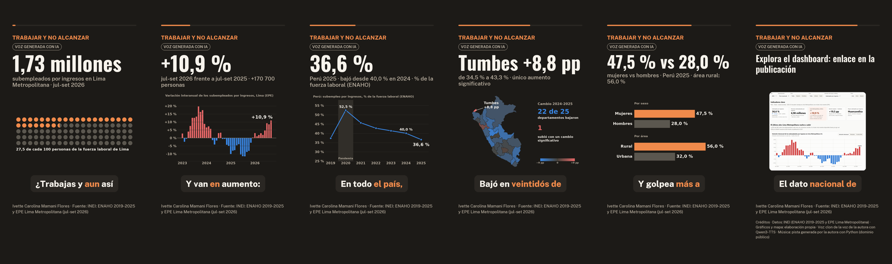

# Guion del reel: «Trabajar y no alcanzar»

Reel vertical de unos 60 segundos (1080 × 1920, 9:16) que cuenta los hallazgos del dashboard. Tiene 6 escenas.
Lo narra una voz generada con IA a partir de la voz de la autora, con un gráfico o mapa en cada escena,
subtítulos sincronizados, música de fondo y créditos.

| Archivo | Qué es |
|---|---|
| `guion.json` | El guion que lee el programa: frase narrada (números en palabras), cifra y etiqueta en pantalla, imagen y fuente de cada cifra |
| `recursos/escena*.png` | Gráficos y mapa de cada escena, hechos con `scripts/graficos_reel.py` a partir de los datos procesados |
| `recursos/musica/musica_generada.mp3` | Música de fondo sintetizada con `generar_musica.py` (dominio público) |
| `hacer_reel.py` + `reel.py` | Voz clonada, subtítulos, control de calidad, mezcla con la música y video (adaptado de la sesión 15) |
| `vista_previa/` | Un cuadro por escena, `storyboard.png` y `subtitulos_borrador.srt`, generados sin voz para revisar el diseño |



## Guion escena por escena

Los tiempos son estimados a 2,5 palabras por segundo, el ritmo que mide la sesión 15 con Qwen3-TTS. El
video final dura lo que dure la voz generada; el programa avisa si queda fuera de 45 a 75 s.

| # | Tiempo | Lo que dice la voz | En pantalla | Imagen | De dónde sale la cifra |
|---|---|---|---|---|---|
| 1 · Gancho | 0-13 s | «¿Trabajas y aun así no te alcanza? En Lima, un millón setecientas treinta mil personas están en esa situación: ganan menos de lo que les toca aportar para la canasta mínima familiar.» | **1,73 millones** · subempleados por ingresos en Lima Metropolitana · jul-set 2026 | Pictograma: 27,5 de cada 100 personas de la fuerza laboral de Lima | EPE del INEI, jul-ago-set 2026: 1 730,5 mil |
| 2 · El último año | 13-22 s | «Y van en aumento: en el último año crecieron diez coma nueve por ciento, más de ciento setenta mil personas.» | **+10,9 %** · jul-set 2026 frente a jul-set 2025 · +170 700 personas | Barras de la variación interanual en Lima, 2023-2026 | EPE: +10,95 % y +170,7 mil |
| 3 · El contraste | 22-35 s | «En todo el país, en cambio, el último dato anual mostraba una mejora: en dos mil veinticinco el subempleo por ingresos bajó de cuarenta a treinta y seis coma seis por ciento.» | **36,6 %** · Perú 2025 · bajó desde 40,0 % en 2024 | Línea nacional 2019-2025, con el pico de la pandemia | ENAHO: 40,02 % → 36,64 % (z = −6,3) |
| 4 · El mapa | 35-41 s | «Bajó en veintidós de veinticinco departamentos. La excepción fue Tumbes: subió ocho coma ocho puntos.» | **Tumbes +8,8 pp** · de 34,5 % a 43,3 % · único aumento significativo | Mapa del cambio 2024-2025 (azul bajó, rojo subió) | ENAHO: Tumbes 34,50 → 43,31 (z = 3,2) |
| 5 · La brecha | 41-50 s | «Y golpea más a las mujeres: cuarenta y siete coma cinco por ciento, frente a veintiocho por ciento de los hombres.» | **47,5 % vs 28,0 %** · mujeres vs hombres · Perú 2025 · área rural: 56,0 % | Barras por sexo y por área | ENAHO 2025: 47,46 % y 28,00 % |
| 6 · Cierre | 50-61 s | «El dato nacional de dos mil veintiséis saldrá recién el próximo año. Mientras tanto, explora el tablero con los datos del Instituto Nacional de Estadística e Informática: el enlace está en la publicación.» | Explora el dashboard: enlace en la publicación · **créditos** | Captura del dashboard | — |

En todo el video aparecen el título, el aviso **«VOZ GENERADA CON IA»**, la barra de avance y el pie
«Ivette Carolina Mamani Flores · Fuente: INEI: ENAHO 2019-2025 y EPE Lima Metropolitana (jul-set 2026)».
La última escena suma los créditos de datos, gráficos, voz y música.

**Por qué la historia va así.** La pregunta era si el subempleo por ingresos aumentó en el último año. La
respuesta honesta tiene dos partes. En Lima, la serie más reciente (EPE, hasta setiembre de 2026) dice que
sí, y con fuerza. En el país, el último dato anual (ENAHO 2025) dice que no, porque bajó. El reel abre con
el dato que sorprende (escenas 1 y 2), lo contrasta con el país (3), lo ubica en el mapa (4), muestra a
quién afecta más (5) y deja claro qué dato falta (6). Así no se exagera ni se afirma algo que los datos no
dicen.

## 1. Graba tu voz de referencia (15 a 25 segundos)

Lee este texto con calma, con el mismo tono que quieres en el reel (cambia el nombre por el tuyo).
Dura unos 20 segundos:

> Hola, soy Ivette Mamani. Estudio ciencia de datos y me interesa entender cómo trabajan y cuánto ganan
> las personas en el Perú. En este video les cuento lo que encontré en las encuestas del INEI sobre el
> subempleo por ingresos, con cifras verificadas y un tablero interactivo que pueden explorar.

- Graba con el celular (una nota de voz de WhatsApp sirve) en un cuarto callado, sin música ni eco, a un palmo del micrófono.
- El clon copia la energía de la grabación: si lees tranquila, la narración saldrá tranquila. Habla claro y con ánimo.
- Guarda el archivo como `tarea_3/reel/voz/mi_voz.m4a` (o `.ogg`, `.opus`, `.wav`). La carpeta `voz/` no se sube a GitHub.
- Solo se clona tu propia voz.

## 2. Revisa el diseño sin voz (opcional, 10 segundos)

```bash
cd tarea_3/reel
python hacer_reel.py --vista-previa      # cuadros en vista_previa/ y subtítulos de borrador
```

## 3. Genera el reel

Va en un entorno propio, como en la sesión 15, porque `qwen-tts` fija su versión de `transformers`.
Las versiones exactas están en `requirements-reel.txt`. La primera vez baja unos 4 GB: torch para CPU,
la voz Qwen3-TTS 0.6B (2,4 GB) y Whisper large-v3-turbo (1,6 GB). Deja al menos 6 GB libres en el disco y
cierra programas pesados: con 8 GB de RAM, la voz tarda unos 20 minutos en CPU.

```bash
# En Windows, crea el entorno en una ruta corta (p. ej. C:\venvs\reel): las rutas de torch superan
# el límite de 260 caracteres dentro de carpetas con nombres largos
uv venv <entorno> --python 3.12
uv pip install --python <entorno> torch==2.15.0 torchaudio==2.11.1 --index-url https://download.pytorch.org/whl/cpu
uv pip install --python <entorno> -r requirements-reel.txt      # con antivirus que inspecciona HTTPS: --system-certs

# Solo Windows, si al importar torch sale «WinError 126 ... shm.dll» (runtime de Visual C++ antiguo):
# copiar junto a torch las DLL que trae msvc-runtime, sin permisos de administrador
cp -n <entorno>/*.dll <entorno>/Lib/site-packages/torch/lib/

cd tarea_3/reel
<entorno>/python generar_musica.py          # solo si no existe recursos/musica/musica_generada.mp3
<entorno>/python hacer_reel.py --voz voz/mi_voz.m4a
```

Queda en `salidas/`: `reel.mp4`, `reel.srt`, `portada.png` y `guion.json` con el WER de cada escena.
En la laptop (CPU) debería tardar entre 5 y 15 minutos.

**Revisa antes de publicar:**

1. Mira el video completo con audio. ¿Se entiende cada cifra? El programa marca con WER alto las escenas
   que Whisper entendió mal y las vuelve a generar una vez. Si una cifra suena rara, cambia su redacción en
   `guion.json` (por ejemplo, «diez coma nueve» por «casi once») **y la cifra en pantalla**, y vuelve a correr.
2. Duración entre 45 y 75 s. Si queda larga, usa `--velocidad 1.08`.
3. La música debe oírse por debajo de la voz. Si quieres otra pista, usa una con licencia que permita el uso
   (por ejemplo, de Pixabay Music) y pásala con `--musica recursos/musica/otra.mp3`. Actualiza el campo
   `creditos` de `guion.json` con el título, el autor y la licencia.
4. Copia el resultado a esta carpeta para entregarlo: `salidas/reel.mp4` → `reel/reel.mp4` y `salidas/reel.srt` → `reel/subtitulos.srt`.

**Plan B si la laptop no puede con la voz:** sube la carpeta `tarea_3/reel` a Google Colab (con GPU,
`--device cuda`) y corre lo mismo. Otra opción es generar la narración con otra herramienta que clone tu
propia voz y montar el video en un editor (CapCut, Canva). En ese caso, usa las imágenes de `recursos/`,
el texto de la tabla y los subtítulos de borrador, y mantén el aviso «Voz generada con IA».

## 4. Replicarlo con otra voz, otra autora u otro tema

1. Edita `guion.json`: `autor`, `fuente`, el `titulo` y, para otro tema, cada escena (frase con los números
   en palabras, cifra, etiqueta, imagen y de dónde sale la cifra) y los `creditos`.
2. Si cambian los datos, regenera las imágenes con `python ../scripts/graficos_reel.py` o pon las tuyas
   en `recursos/` (900 × 570 px).
3. Revisa el diseño con `python hacer_reel.py --vista-previa`.
4. Graba tu voz (paso 1) y genera el reel (paso 3). Solo se clona la voz propia o una con autorización expresa.

## Checklist del reel (rúbrica de la Parte 3)

- [x] Guion de 6 escenas, gancho al inicio y cierre con invitación al dashboard
- [x] Cifras verificadas contra los datos procesados (columna «De dónde sale la cifra»)
- [x] Gráficos, mapa y captura del dashboard en cada escena
- [x] Música de fondo con licencia (pista propia, dominio público) por debajo de la voz
- [x] Aviso «Voz generada con IA», fuente de los datos y créditos
- [x] Voz de referencia grabada por la autora (22,4 s)
- [x] Narración con Qwen3-TTS 0.6B en CPU y video generado: **64,7 s**, WER por escena de 0,00 a 0,07
- [x] `reel.mp4` (3,4 MB), `subtitulos.srt` y `portada.png` copiados a esta carpeta

## Resultado de la generación (1 de noviembre de 2026)

| | |
|---|---|
| Duración | 64,7 s (la tarea pide de 45 a 75 s) |
| Formato | 1080 × 1920, 30 fps, H.264 + AAC estéreo de 48 kHz, 3,4 MB |
| Volumen | −15,8 LUFS integrado: la voz a −14 LUFS y la música a −32 LUFS, por debajo |
| WER por escena | 0,03 · 0,05 · 0,03 · 0,07 · 0,05 · 0,00 (escena 6 rehecha; Whisper entiende casi todas las palabras) |
| Tiempo en la laptop | unos 22 minutos el reel completo; 13 minutos para rehacer solo la escena 6 |

**Corrección de la escena 6.** Al escuchar el reel, la autora notó que la voz leía la sigla «INEI» letra por
letra y repetía «iii» al final. La frase pasó a decir el nombre completo, «del Instituto Nacional de
Estadística e Informática», y solo esa escena se volvió a narrar:

```bash
python hacer_reel.py --voz voz/mi_voz.m4a --rehacer-escena 6 --intentos 3
```

Ese comando genera 3 versiones de la escena y se queda con la que Whisper entiende mejor, que delata
repeticiones como el «iii». Después la pega en `salidas/reel.wav` (la versión anterior queda en
`reel_anterior.wav`) y rehace los subtítulos y el video. Para corregir solo un subtítulo, sin tocar la voz,
existen `correcciones_subtitulos` en `guion.json` y `python hacer_reel.py --rehacer-video`.
