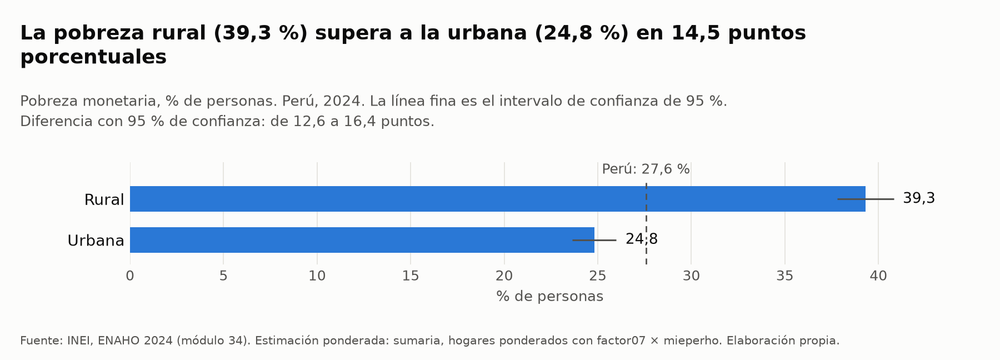
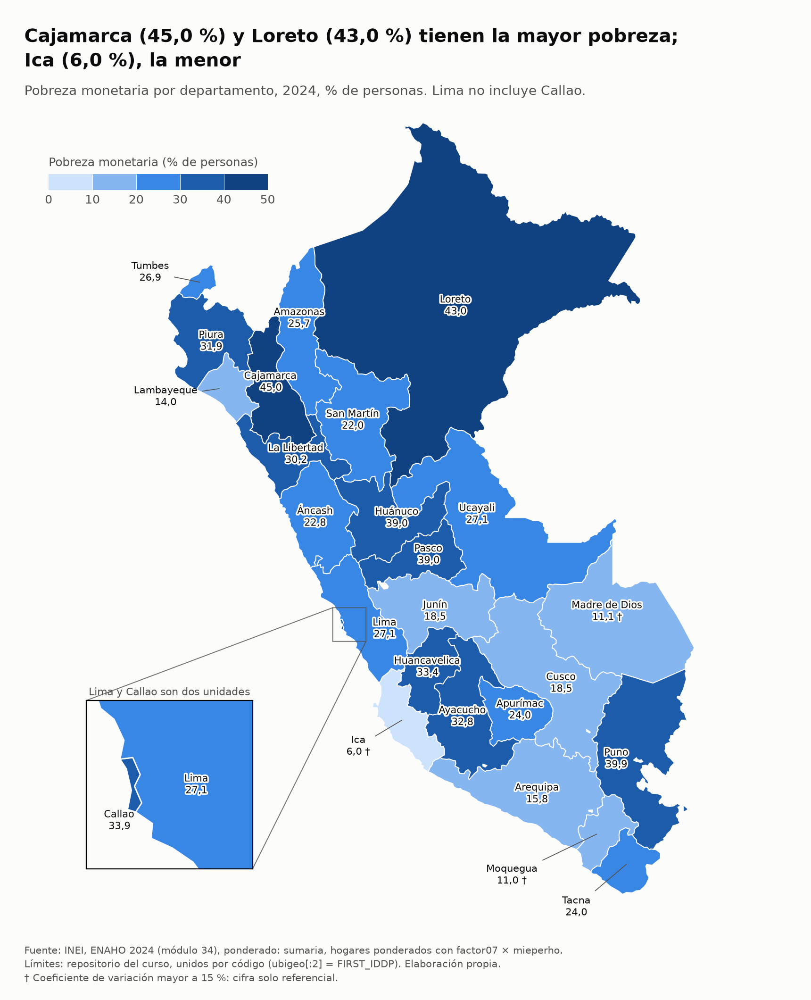

# Tarea 4 · Agente de investigación socioeconómica del Perú

**Pregunta guía:** ¿puede un agente de IA investigar la realidad socioeconómica peruana con datos oficiales del INEI
(ENAHO 2024) y del BCRP, combinando servidores MCP, Skills de Claude Code y análisis reproducible?

| Parte | Componente | Estado |
|---|---|---|
| 1 | Servidor MCP del BCRP (`mcp/`) | ✅ Terminada: 10 de 10 pruebas aprobadas |
| 2 | Skills para limpiar, graficar y mapear la ENAHO (`.claude/skills/`) | ✅ Terminada: 25 validaciones aprobadas, pobreza 27,58 %, 25 de 25 unidades |
| 3 | Integración y agente de investigación (`informes/`) | ✅ Terminada: 4 Skills y 3 herramientas MCP en una ejecución; 13 de 13 cifras verificadas |
| 4 | Evaluación, documentación y reproducibilidad (`evaluacion/`) | Pendiente |

## Instalación

Se necesitan [uv](https://docs.astral.sh/uv/), [Claude Code](https://claude.com/claude-code) con la sesión iniciada e
internet. No se usa ninguna clave de API.

```bash
cd tarea_4
uv sync                  # crea .venv con FastMCP 4, pandas, PyArrow, GeoPandas y Matplotlib (fijados en uv.lock)
uv run pytest -q         # 10 passed: el servidor MCP
uv run pytest pruebas -q # 31 passed: las Skills de la ENAHO y la integración
```

Si hay un antivirus o proxy que inspecciona HTTPS (por ejemplo, Avast), usen `uv sync --system-certs`. El servidor ya
usa los certificados del sistema mediante `truststore`, así que no necesita nada más.

La primera vez, el servidor baja el catálogo oficial del BCRP (17 167 series, unos 7 MB) a `datos/bcrp/`. Git ignora
esa carpeta, y basta con borrarla para volver a bajar el catálogo.

## Estructura

```
tarea_4/
├── README.md
├── pyproject.toml · uv.lock      # entorno reproducible con uv
├── .mcp.json                     # conecta el servidor bcrp a Claude Code
├── .gitignore                    # ignora .venv/, datos/ y las bases procesadas
├── mcp/
│   ├── server.py                 # servidor MCP del BCRP (FastMCP)
│   ├── test_server.py            # 8 pruebas originales de la Sesión 04 + 2 propias
│   └── demo_claude.py            # demostración reproducible con claude -p
├── .claude/skills/
│   ├── limpiando-enaho/          # SKILL.md, reference.md, scripts/limpiar.py y scripts/estimar.py
│   ├── graficando-enaho/         # SKILL.md y scripts/graficar.py
│   ├── mapeando-enaho/           # SKILL.md, scripts/mapear.py y referencias/ de la Sesión 16
│   └── investigando-peru/        # SKILL.md, scripts/graficar_bcrp.py y scripts/cruzar.py
├── pruebas/                      # test_skills.py y test_integracion.py: 31 pruebas
├── salidas/                      # validaciones, indicadores, series del BCRP y cruce
├── figuras/  ·  mapas/           # gráficos y mapas generados por las Skills
├── informes/
│   ├── informe_final.md · plan.md   # generados por el agente
│   └── verificacion.md · verificar.py   # comprobación independiente de las cifras
└── evidencias_ia/
    ├── mcp/                      # transcripciones de las demostraciones del MCP
    ├── skills/                   # transcripciones de las demostraciones de las Skills
    └── integracion/              # la ejecución del agente, su primera corrida y el caso sin datos
```

---

## Parte 1 · Servidor MCP del BCRP

`mcp/server.py` parte del proyecto de la
[Sesión 04](https://github.com/d2cml-ai/Data-Science-Python/tree/main/sessions/04-mcp-claude-code/proyecto). Ahí,
`buscar_series` ya venía hecha y se mantiene igual. Lo demás se agregó en esta tarea. Todas las cuentas las hace
Python con pandas, y el modelo solo lee los resultados. Así cada cifra sale de una llamada que se puede repetir.

### Arquitectura

```
Claude Code ──stdio──► mcp/server.py (FastMCP "bcrp")
                          │
                          ├─ catálogo: estadisticas.bcrp.gob.pe/estadisticas/series/metadata  → datos/bcrp/ (caché en disco)
                          └─ datos:    estadisticas.bcrp.gob.pe/estadisticas/series/api/{código}/json/{desde}/{hasta}
                                       (caché en memoria; reintenta con 2, 4, 8 y 16 s si el BCRP devuelve HTML)
```

### Herramientas

| Herramienta | Qué hace | Ejemplo de argumentos |
|---|---|---|
| `buscar_series` | Busca por palabras en la categoría, el grupo y el nombre de las 17 167 series. Devuelve primero las vigentes. También acepta un código | `texto="ipc 12 meses"` |
| `serie` | Descarga los datos de un periodo, sin los `n.d.`. Devuelve los periodos como `2025-01`, `2026-10-01`, `2025-T1` o `2025` | `codigo="PN01271PM", desde="2025-01", hasta="2025-12"` |
| `resumen` | Calcula el primer y último dato, el cambio, la variación %, el promedio, la desviación estándar, el máximo y el mínimo (cada extremo con su periodo). Si la serie ya es una tasa, avisa que el cambio está en puntos porcentuales | `codigo="PN01273PM", desde="2025-12", hasta="2026-09"` |
| **`correlacion`** (propia) | Calcula la correlación entre dos series, con periodos alineados, faltantes tratados y rezago opcional | `codigo_a="PN01273PM", codigo_b="PD04638PD", desde="2024-01", hasta="2025-12"` |
| `guardar_series` (Parte 3) | Guarda hasta 60 series en `salidas/bcrp/{nombre}.csv` para que los scripts las procesen sin que ninguna cifra pase por el modelo. Informa las que no tienen datos | `codigos=["PM40050BA"], desde="2020", hasta="2024", nombre="agro_nacional"` |

Todas las herramientas devuelven tres datos de procedencia:

- `fuente`: la URL de la API.
- `fuente_web`: la tabla del BCRP donde una persona puede comprobar la cifra.
- `fuente_original`: quién produce el dato, por ejemplo INEI o SBS.

Las URL citan el rango de los datos devueltos y no el pedido, así que al abrirlas después muestran las mismas cifras.

Las fechas se aceptan como `2025`, `2025-T1`, `2025-03` o `2025-03-15`, y se adaptan a la frecuencia de cada serie.
Por ejemplo, `desde="2025"` en una serie diaria empieza el 1 de enero. Las fechas imposibles, como `2025-13` o
`2025-02-30`, dan un error claro; pandas, en cambio, convertía `2025-13` en enero de 2026 sin avisar.

Otros errores también son claros:

- Un código inexistente da un `ToolError` que nombra el código.
- Un periodo sin datos dice desde cuándo hay datos.
- Una consulta de más de 3 000 datos sugiere usar `resumen` o `correlacion`, para no llenar el contexto del modelo.

### Herramienta propia: `correlacion`

**Para qué sirve.** Responde preguntas que las otras tres herramientas no resuelven, como *«¿se mueven juntos el tipo
de cambio y la inflación?»* o *«¿las expectativas de inflación se anticipan a la inflación?»*. Hacerlo a mano exige
varios pasos donde un modelo de lenguaje suele equivocarse: alinear frecuencias distintas, emparejar periodos y descartar
faltantes. La herramienta hace estos pasos, en orden:

1. **Alinea frecuencias.** Si una serie es diaria y la otra mensual, lleva la más fina a la más gruesa con el promedio de
   cada periodo, y avisa cuántos datos promedió.
2. **Trata los faltantes.** Empareja periodo con periodo sobre un calendario completo. Descarta los periodos que no
   tienen dato en alguna de las dos series y dice cuántos descartó de cada una.
3. **Aplica el rezago.** `rezago=k` compara A en *t* con B en *t − k* y baja B desde *k* periodos antes, para no perder
   pares.
4. **Calcula.** Devuelve Pearson con su intervalo de confianza al 95 % y su p-valor aproximados con la transformación de
   Fisher. También devuelve Spearman y la **correlación de las variaciones** periodo a periodo. Si los niveles están muy
   correlacionados pero las variaciones no, la herramienta advierte una posible correlación espuria por tendencia común.
5. **Recuerda los límites.** Siempre agrega que una correlación no prueba causalidad y que, en series de tiempo, el
   p-valor suele ser optimista.

Con 120 pares o menos, devuelve también los datos emparejados para que se puedan revisar.

**Cómo se validó.** Las dos pruebas propias calculan la verdad por su cuenta, con `statistics.correlation` de la
biblioteca estándar sobre los datos de `serie`, sin reutilizar el código de pandas del servidor:

| Prueba | Qué comprueba |
|---|---|
| `test_correlacion_alinea_frecuencias_y_coincide_con_un_calculo_independiente` | Toma la inflación a 12 meses (mensual) y el tipo de cambio venta (diario) de 2024-2025. Comprueba que la frecuencia común es la mensual, que hay 24 pares, que el promedio mensual de los días coincide, que Pearson coincide con el cálculo independiente (±0,0001), que el resultado es simétrico y que el intervalo contiene la estimación |
| `test_correlacion_trata_faltantes_y_rezago` | El tipo de cambio diario empieza el 2 de enero de 1997, así que entre 1996-07 y 1997-12 descarta exactamente 6 meses. Con `rezago=1` sobre la misma serie da la autocorrelación de orden 1. Con menos de 4 pares, la herramienta da un error en vez de un número |

Además, se comprobó que las pruebas detectan errores reales. Se introdujeron tres fallas a propósito en una copia del
servidor, y cada una hizo fallar una prueba:

- usar el último dato del mes en vez del promedio;
- invertir el signo del rezago;
- no ampliar el rango de B cuando hay rezago.

### Recurso y prompt

| Tipo | Nombre | Qué da |
|---|---|---|
| Recurso (plantilla) | `bcrp://serie/{codigo}` | Ficha de la serie: nombre, categoría, grupo de serie, grupo de publicación, área del BCRP que la publica, fuente original, frecuencia, inicio de los datos, fecha de actualización, enlaces a la tabla web y a la API, y cómo citarla |
| Prompt | `informe(tema, desde="2024-01", hasta="")` | Guía para un informe breve: de 2 a 4 series, `resumen` para cada una, `correlacion` si el tema relaciona dos indicadores, nada de cuentas a mano, una tabla con código, periodo, cifra y unidad, tres hallazgos, limitaciones y fuentes |

### Conexión con Claude Code

`.mcp.json` registra el servidor con alcance de proyecto. Es equivalente a
`claude mcp add --scope project bcrp -- uv run --quiet mcp/server.py`:

```json
{ "mcpServers": { "bcrp": { "type": "stdio", "command": "uv", "args": ["run", "--quiet", "mcp/server.py"], "env": {} } } }
```

Abran `claude` **dentro de `tarea_4/`** y aprueben el servidor `bcrp` cuando se lo pida. Luego prueben:

1. `/mcp`: muestra `bcrp` conectado, con sus 5 herramientas.
2. Una pregunta: *«¿Cuál fue la inflación de Lima a 12 meses en setiembre de 2026?»*. Claude debería llamar a
   `buscar_series` y luego a `resumen` o `serie`, en vez de calcular.
3. El recurso: `@bcrp:bcrp://serie/PN01273PM ¿qué área del BCRP publica esta serie?`
4. El prompt: `/mcp__bcrp__informe inflación 2025-01`

### Demostración reproducible

`mcp/demo_claude.py` corre `claude -p` sin terminal ni archivos (`--tools ""`) y con `bcrp` como único servidor MCP.
Así, cada cifra de la respuesta tiene que salir de una herramienta. El script guarda la transcripción completa (`.jsonl`)
y un resumen legible (`.md`) con cada llamada, sus argumentos, lo que devolvió y la respuesta final.

```bash
uv run mcp/demo_claude.py                                                            # pregunta de la tabla
MSYS_NO_PATHCONV=1 uv run mcp/demo_claude.py "/mcp__bcrp__informe inflación 2025-01" --nombre demo_prompt_informe
uv run mcp/demo_claude.py "Lee el recurso bcrp://serie/PN01273PM ..." --modo recursos --nombre demo_recurso
```

`MSYS_NO_PATHCONV=1` solo hace falta en Git Bash, que si no convierte `/mcp__...` en una ruta de Windows. En PowerShell
no se necesita.

Resultados del 4 de noviembre de 2026 con Sonnet:

| Demostración | Qué pide | Llamadas de Claude | Resultado |
|---|---|---|---|
| [`demo_claude_code`](evidencias_ia/mcp/demo_claude_code.md) | Evolución de la inflación interanual de Lima desde dic-2024 y si se movió con el tipo de cambio | `buscar_series` ×2 → `resumen` → `correlacion` | Inflación de 1,97 % (2024-12) a 4,55 % (2026-09), +2,58 p. p., máximo en 2026-09 (PN01273PM). Con el tipo de cambio diario PD04638PD promediado por mes, Pearson −0,47 en niveles y +0,65 en variaciones: Claude lo reporta como señales contradictorias y sin causalidad |
| [`demo_prompt_informe`](evidencias_ia/mcp/demo_prompt_informe.md) | El prompt `/mcp__bcrp__informe inflación 2025-01` | `buscar_series` ×3 → `resumen` ×4 → `correlacion` | Informe con tabla de códigos y periodos, 3 hallazgos (el alza viene del IPC no subyacente: de 0,43 % a 8,20 %), limitaciones y fuentes |
| [`demo_recurso`](evidencias_ia/mcp/demo_recurso.md) | Leer la ficha `bcrp://serie/PN01273PM` sin acceso a las herramientas | `ReadMcpResourceTool` | Área: Departamento de Estadísticas de Precios; fuente original: INEI; datos desde ene-1950; texto para citarla |

Las transcripciones se limpiaron: del evento inicial de Claude Code solo quedan el modelo, la versión, las
herramientas y los servidores MCP.

### Pruebas

```text
$ uv run pytest -v
mcp/test_server.py::test_buscar_encuentra_el_ipc PASSED
mcp/test_server.py::test_cuatro_herramientas_como_minimo PASSED
mcp/test_server.py::test_serie_mensual PASSED
mcp/test_server.py::test_serie_diaria PASSED
mcp/test_server.py::test_resumen_sin_cuentas_a_mano PASSED
mcp/test_server.py::test_codigo_inexistente_da_un_error_claro PASSED
mcp/test_server.py::test_un_recurso PASSED
mcp/test_server.py::test_un_prompt PASSED
mcp/test_server.py::test_correlacion_alinea_frecuencias_y_coincide_con_un_calculo_independiente PASSED
mcp/test_server.py::test_correlacion_trata_faltantes_y_rezago PASSED
10 passed
```

Las 8 pruebas originales son **idénticas byte a byte** a las de la Sesión 04: los primeros 2 455 bytes de
`mcp/test_server.py` coinciden con el archivo original (`cmp`). Las 2 propias van después, separadas por un
comentario. Ni siquiera el import cambió: `from server import mcp` funciona porque pytest agrega `mcp/` al `sys.path`
(`testpaths = ["mcp"]` en `pyproject.toml`). Las pruebas piden datos reales al BCRP, así que necesitan internet.

---

## Parte 2 · Skills de la ENAHO

Tres Skills de `.claude/skills/` procesan los microdatos de la ENAHO 2024, con la metodología de la
[Sesión 16](https://github.com/d2cml-ai/Data-Science-Python/tree/main/sessions/16-skills-enaho): lo que no se discute
(llaves, filtros, uniones, pesos, validación) va en un script que la Skill corre tal cual, y lo que requiere criterio va
en `SKILL.md`. Toda cifra, incluidos los títulos de los gráficos, sale del procesamiento: ninguna se escribe a mano.

| Skill | Entra | Sale |
|---|---|---|
| `limpiando-enaho` | Los zip de los módulos 34 y 02 | `salidas/personas_2024.parquet`, `hogares_2024.parquet`, `indicadores.csv` y `validacion.txt` |
| `graficando-enaho` | La base limpia y un pedido en lenguaje natural | `figuras/*.png` a 200 dpi |
| `mapeando-enaho` | La base limpia y el GeoJSON departamental | `mapas/*.png`, `salidas/comparacion_mapa.csv` y `validacion_mapa.txt` |

### Datos

| Archivo | Una fila por | Filas | Enlace |
|---|---|---|---|
| ENAHO 2024, módulo 34 (sumaria) | hogar | 33,691 | [966-Modulo34.zip](https://proyectos.inei.gob.pe/iinei/srienaho/descarga/STATA/966-Modulo34.zip) |
| ENAHO 2024, módulo 02 (miembros) | persona | 117,721 | [966-Modulo02.zip](https://proyectos.inei.gob.pe/iinei/srienaho/descarga/STATA/966-Modulo02.zip) |
| Límites departamentales | departamento | 25 | [peru_departamental_simple.geojson](https://raw.githubusercontent.com/d2cml-ai/Data-Science-Python/main/sessions/06-geoespacial/lab/Data/peru_departamental_simple.geojson) |

No hay que bajar nada a mano: `limpiar.py` y `mapear.py` descargan lo que falte a `datos/`, que Git ignora. Si el portal
del INEI no responde, el script dice dónde guardar el archivo bajado desde el navegador. Las bases procesadas tampoco se
suben: se regeneran en segundos. Sí se suben las validaciones y los indicadores.

### Reproducir todo sin Claude Code

```bash
uv run .claude/skills/limpiando-enaho/scripts/limpiar.py
uv run .claude/skills/graficando-enaho/scripts/graficar.py --por area
uv run .claude/skills/graficando-enaho/scripts/graficar.py --por sexo
uv run .claude/skills/graficando-enaho/scripts/graficar.py --por grupo_edad
uv run .claude/skills/graficando-enaho/scripts/graficar.py --por departamento
uv run .claude/skills/mapeando-enaho/scripts/mapear.py
```

### `limpiando-enaho`

`limpiar.py` sigue siempre el mismo orden:

1. **Lee** los `.dta` desde el zip con `convert_categoricals=False`. Elige `sumaria-2024.dta`, no `sumaria-2024-12g.dta`
   del mismo zip.
2. **Normaliza** los nombres a minúscula; `aÑo` queda `anio`.
3. **Filtra** a los residentes habituales: `((p204 == 1) & (p205 == 2)) | ((p204 == 2) & (p206 == 1))`.
4. **Une** personas y hogares por `conglome`, `vivienda` y `hogar` con `merge(..., validate="m:1")`.
5. **Construye** `departamento = ubigeo[:2]`, `urbano = estrato <= 5`, `pobre = pobreza <= 2` y `pobre_extremo`.
6. **Valida** y escribe `salidas/validacion.txt`.
7. **Guarda** las bases y `salidas/indicadores.csv` solo si todo lo esencial pasó.

**Dos bases, según la unidad de análisis.** Las cifras publicadas por el INEI usan la sumaria con `factor07 × mieperho`.
Sexo y edad solo existen por persona, y ahí se usan los residentes habituales con `facpob07`. Cada gráfico y cada fila
de `indicadores.csv` usa una sola base y dice cuál.

| Indicador | Calculado | Referencia |
|---|---:|---:|
| Pobreza nacional (`factor07 × mieperho`) | 27.58 % | 27.6 % |
| Pobreza nacional (residentes, `facpob07`) | 27.53 % | 27.6 % |
| Pobreza urbana | 24.81 % | 24.8 % |
| Pobreza rural | 39.30 % | 39.3 % |
| Pobreza extrema | 5.50 % | 5.5 % |
| Lima Metropolitana | 28.21 % | 28.2 % |
| Residentes habituales | 108,664 | 108,664 |
| Unidades territoriales | 25 | 25 |

Las dos cifras nacionales difieren porque cubren poblaciones distintas: `mieperho` cuenta a los 109,842 miembros del
hogar (`p204 == 1`) y los residentes habituales son 108,664. Ambas quedan a 0.1 puntos o menos de la referencia.

**Por qué importa el factor.** Sin ponderar saldría 20.22 % (hogares) o 25.61 % (personas), y con `factor07` sin
`mieperho`, 21.85 %, que es el porcentaje de hogares pobres y no de personas.

[`salidas/validacion.txt`](salidas/validacion.txt) tiene 25 comprobaciones sobre lectura, llaves, unión, territorio,
factores y pobreza. Dos ejemplos que van más allá del mínimo: la población expandida (34.5 millones) y la variable
`pobreza`, que se reproduce en el 100 % de los hogares comparando el gasto por persona con la línea de pobreza.

Si falla una comprobación esencial, el archivo marca `[FALLA]` y `RESULTADO: RECHAZADA`, no queda ninguna base procesada y
el proceso termina con error. Las cifras de referencia solo se comparan: ningún paso las usa para ajustar un resultado.
La validación atrapó un error real durante el desarrollo: `mieperho` llega como `int8` y `12 × mieperho` se desbordaba
en hogares de 11 miembros o más, así que la pobreza se reproducía solo en el 99.94 % de los hogares. Se corrigió el
cálculo, no la comprobación.

### Error de muestreo

`estimar.py` calcula también el error estándar según el diseño de la muestra: la UPM es `conglome` y los estratos son
departamento × estrato, porque la Ficha Técnica describe una muestra independiente en cada departamento. Con eso, los
gráficos separan las diferencias reales del azar de la muestra. Para Perú, el intervalo de 95 % va de 26.6 % a 28.6 %.

- Un control independiente con jackknife de UPM dio errores casi iguales: 0.5055 frente a 0.5057 en Perú y 2.12 frente a
  2.13 en Cajamarca.
- La diferencia entre dos grupos usa su propio intervalo, porque esos grupos comparten hogares y conglomerados. El mismo
  control dio 1.65 frente a 1.66 para mujeres y hombres en Puno.
- Un coeficiente de variación mayor a 15 % se marca con † como cifra solo referencial. Es una regla práctica de este
  proyecto.
- El INEI no publica estos intervalos en los archivos usados, así que no se pudieron comparar con cifras oficiales.

### `graficando-enaho`

`SKILL.md` traduce el pedido a opciones de `graficar.py`: `--por`, `--indicador` y `--solo columna=valor`. El script
escribe el título con el hallazgo, dibuja barras desde cero con su intervalo y marca en tono suave a los grupos que no se
distinguen del total.

| Figura | Hallazgo |
|---|---|
| [`pobreza_area.png`](figuras/pobreza_area.png) | Rural 39,3 % y urbana 24,8 %: 14,5 puntos de diferencia (IC 95 %: 12,6 a 16,4) |
| [`pobreza_sexo.png`](figuras/pobreza_sexo.png) | Mujeres 27,7 % y hombres 27,4 %: la diferencia incluye el cero (IC 95 %: −0,3 a 0,9), no se distingue del error de muestreo |
| [`pobreza_grupo_edad.png`](figuras/pobreza_grupo_edad.png) | Más alta entre 0 y 14 años (37,5 %) y más baja entre 45 y 59 (21,4 %) |
| [`pobreza_departamento.png`](figuras/pobreza_departamento.png) | Frente al total nacional: 9 departamentos por encima, 9 por debajo y 7 sin diferencia distinguible |
| [`pobreza_dominio.png`](figuras/pobreza_dominio.png) | Sierra norte 45,7 % y Costa centro 14,0 % |
| [`pobreza_sexo_departamento-puno.png`](figuras/pobreza_sexo_departamento-puno.png) | Pedido en lenguaje natural: en Puno, mujeres 42,9 % y hombres 37,8 %, 5,1 puntos (IC 95 %: 1,9 a 8,3) |



### `mapeando-enaho`

`mapear.py` une por código, `ubigeo[:2]` con `FIRST_IDDP`, con `validate="1:1"`. Exige 25 unidades con dato y mantiene
Lima (15) y Callao (07) separados; un recuadro muestra a los dos. Si la unión falla o una cifra se aleja de la referencia,
termina con error y no guarda el mapa.

La comparación con el archivo de la Sesión 16 está en
[`salidas/comparacion_mapa.csv`](salidas/comparacion_mapa.csv): la diferencia máxima es 0.05 puntos (Amazonas), con una
referencia redondeada a un decimal. Ese archivo solo se compara: las cifras del mapa salen de la base procesada.



### Activación y coordinación

Abran `claude` **dentro de `tarea_4/`**. Las Skills se pueden llamar con `/limpiando-enaho`, `/graficando-enaho` y
`/mapeando-enaho`, o activar con un pedido en lenguaje natural.

Las demostraciones son sesiones independientes de `claude -p` con Sonnet, solo con las Skills, Read y Bash limitado a
`uv run`. Para las de coordinación se apartaron antes las bases procesadas. Se corrieron el 6 de noviembre de 2026:

```bash
uv run mcp/demo_claude.py "Haz un mapa de la pobreza monetaria por departamento con ENAHO 2024." --modo skills --carpeta skills --nombre demo_coordinacion_mapa
```

| Demostración | Pedido | Skills activadas | Scripts, en orden | Resultado |
|---|---|---|---|---|
| [`demo_coordinacion_mapa`](evidencias_ia/skills/demo_coordinacion_mapa.md) | *Haz un mapa de la pobreza monetaria por departamento con ENAHO 2024.* (sin base) | `mapeando-enaho` → `limpiando-enaho` | `limpiar.py` → `mapear.py` | Mapa con 25 de 25 unidades, Cajamarca 45,0 % e Ica 6,0 % |
| [`demo_coordinacion_grafico`](evidencias_ia/skills/demo_coordinacion_grafico.md) | *Grafica la pobreza por grupos de edad con la ENAHO 2024.* (sin base) | `graficando-enaho` → `limpiando-enaho` | `limpiar.py` → `graficar.py` | Gráfico por edad; 0-14 años, 37,5 % |
| [`demo_natural_cifra`](evidencias_ia/skills/demo_natural_cifra.md) | *¿Cuál fue la pobreza en Cusco en 2024?* | `limpiando-enaho` | `estimar.py` | 18,5 %, igual a la referencia de la sesión |
| [`demo_natural_grafico`](evidencias_ia/skills/demo_natural_grafico.md) | *Grafica la pobreza urbana y rural.* | `graficando-enaho` | `graficar.py` | 24,8 % y 39,3 % |
| [`demo_directa_limpieza`](evidencias_ia/skills/demo_directa_limpieza.md) | `/limpiando-enaho 2024` (sin base) | `limpiando-enaho` | `limpiar.py` | 25 comprobaciones aprobadas |
| [`demo_directa_grafico`](evidencias_ia/skills/demo_directa_grafico.md) | `/graficando-enaho pobreza por sexo en Puno` | `graficando-enaho` | `graficar.py` | 42,9 % y 37,8 % |
| [`demo_directa_mapa`](evidencias_ia/skills/demo_directa_mapa.md) | `/mapeando-enaho pobreza extrema` | `mapeando-enaho` | `mapear.py` | Mapa de pobreza extrema; Claude señaló tres fallas del script |

En las dos primeras, Claude abre la Skill que le pidieron, ve que falta la base, carga `limpiando-enaho` y solo entonces
continúa: la limpieza siempre se ejecuta antes que el gráfico o el mapa.

`demo_directa_mapa` encontró problemas reales, que se corrigieron después: el título se cortaba, la escala tenía solo dos
clases y la validación pisaba la del mapa oficial, cuya comparación tampoco aplica a la pobreza extrema. Esa transcripción
y sus quejas corresponden a la versión anterior de `mapear.py`; [`pobreza_extrema_departamento.png`](mapas/pobreza_extrema_departamento.png)
ya es la versión corregida. Las demás demostraciones no dependen de esos cambios. Una segunda corrida completa con el
código final se detuvo por falta de memoria en la laptop y queda pendiente.

### Pruebas

`pruebas/test_skills.py` tiene 20 pruebas, separadas de las 10 del MCP para que `uv run pytest` siga dando `10 passed`.
Con las de la integración, `uv run pytest pruebas -q` da `31 passed`.

| Grupo | Qué comprueba |
|---|---|
| Estimador | El valor y el error estándar coinciden con un cálculo a mano sobre una muestra de juguete; el peso cambia el resultado; un subgrupo conserva las UPM de fuera |
| Datos reales | Las validaciones aprueban y se reproducen 27.58 % y 27.53 % |
| Daños a propósito | Siete daños hacen fallar su comprobación: llaves sin ceros, factor a la mitad, sin factor, pobreza alterada, persona repetida, sin Callao y filtro equivocado |
| Parada | Un hogar repetido rompe la unión; un módulo dañado termina en error, `RESULTADO: RECHAZADA` y sin bases, incluso si había una anterior |
| Mapa | Une las 25 unidades; rechaza una llave sin cero y la falta de Callao; coincide con la Sesión 16 |
| Mensajes | Sin base, pide correr `limpiando-enaho`; otro año se rechaza |

---

## Parte 3 · Agente de investigación

**Pregunta:** ¿cómo evolucionaron las agroexportaciones peruanas entre 2020 y 2024, y los departamentos que más
agroexportaban en 2022 tenían menos pobreza monetaria en 2024?

El informe entiende agroexportaciones como la suma de los productos tradicionales agrícolas y los no tradicionales
agropecuarios. La pregunta exige las dos fuentes: el BCRP mide las exportaciones y la ENAHO, la pobreza. La ENAHO no
registra exportaciones, y el BCRP no mide pobreza.

**[Informe final](informes/informe_final.md)** · [plan](informes/plan.md) · [verificación](informes/verificacion.md) ·
[ejecución completa](evidencias_ia/integracion/ejecucion_agente.md)

### Cómo funciona el agente

```
/investigando-peru <pregunta>
  1. Plan                 informes/plan.md
  2. MCP del BCRP         buscar_series · recurso bcrp://serie/{codigo} · resumen · guardar_series  ──► salidas/bcrp/*.csv
  3. Skills de la ENAHO   limpiando-enaho ─► graficando-enaho ─► mapeando-enaho                     ──► bases, gráfico, mapa
  4. Cruce                graficar_bcrp.py · cruzar.py                                              ──► salidas/, figuras/
  5. Contraste            validaciones, referencia de la Sesión 16 y total nacional
  6. Informe              informes/informe_final.md
```

Dos piezas se agregaron para unir ambos mundos sin copiar cifras a mano:

- **`guardar_series`:** el MCP escribe los datos en un CSV, y un script los lee. Así el modelo elige las series, pero
  ningún número pasa por él.
- **`investigando-peru`:** la cuarta Skill coordina el trabajo. `cruzar.py` une por departamento, contrasta la suma con el
  total nacional, compara a los 5 mayores exportadores con el resto según el diseño de la muestra y repite todo sin Lima
  y Callao y por grupo de producto.

Las series regionales del BCRP no traen ubigeo: el departamento solo aparece en su nombre. `cruzar.py` lo convierte al
código del INEI y exige identificar las 25 unidades. `informes/verificar.py` confirma la suma derivando el departamento de
la posición del código de cada serie, no del nombre.

### Reproducir la ejecución

```bash
MSYS_NO_PATHCONV=1 uv run mcp/demo_claude.py "/investigando-peru ¿Cómo evolucionaron las agroexportaciones peruanas entre 2020 y 2024, y los departamentos que más agroexportaban en 2022 tenían menos pobreza monetaria en 2024? Entiende agroexportaciones como la suma de los productos tradicionales agrícolas y los no tradicionales agropecuarios." --modo completo --carpeta integracion --nombre ejecucion_agente
uv run informes/verificar.py
```

También se puede escribir el pedido `/investigando-peru ...` en una sesión de `claude` abierta dentro de `tarea_4/`.

### Ejecución demostrable

Fue una sola sesión de `claude -p` con Sonnet, el 6 de noviembre de 2026, partiendo sin las bases procesadas: 37 turnos,
213 segundos y US$ 0,61.

| Requisito | Pedido | Logrado |
|---|---|---|
| Herramientas MCP distintas | Al menos 2 | 3: `buscar_series` ×4, `guardar_series` ×3 y `resumen` ×2, más el recurso ×3 |
| Skills distintas | Al menos 2 | 4: `investigando-peru`, `limpiando-enaho`, `graficando-enaho` y `mapeando-enaho` |
| Scripts, en orden | | `limpiar.py`, `graficar.py`, `mapear.py`, `graficar_bcrp.py` y `cruzar.py` |

Durante la ejecución, el agente notó que dos series nacionales repetían los valores de otras dos y las sacó para no
sumarlas dos veces.

### Hallazgos

1. **Las agroexportaciones crecieron 65,08 %:** de 7 466,5 millones de US$ en 2020 a 12 325,6 en 2024, en dólares
   corrientes. No mide volumen.
2. **Estaban concentradas:** en 2022, La Libertad, Lima, Ica, Piura y Lambayeque reunieron el 77,72 %.
3. **La pobreza de esos cinco fue menor, pero el resultado no es firme:** 26,0 % frente a 29,3 % del resto, con una
   diferencia que se distingue del error de muestreo. Sin Lima y Callao pasa a 28,1 % frente a 27,2 %, y deja de
   distinguirse. La correlación de rangos es −0,17 (p = 0,41).
4. **La respuesta depende de la definición:** solo con los no tradicionales hay una brecha distinguible; solo con los
   tradicionales, no.

**Conclusión del informe:** los datos no permiten afirmar que los departamentos que más agroexportaban tuvieran menos
pobreza. Ica y Lambayeque combinan mucha exportación y poca pobreza, y Piura y Cajamarca, todo lo contrario.

### Verificación y manejo de errores

[`informes/verificacion.md`](informes/verificacion.md) recalcula 13 afirmaciones de las dos fuentes por un camino
distinto: las series mensuales del BCRP, no las anuales, y los `.dta` originales con una media ponderada propia. Las 13
coinciden. El archivo trae además tres comprobaciones manuales con sus enlaces, las tres frases sin respaldo que se
corrigieron a mano en el informe y las fallas de la primera corrida.

| Evidencia | Qué muestra |
|---|---|
| [`ejecucion_agente`](evidencias_ia/integracion/ejecucion_agente.md) | La ejecución final |
| [`primera_corrida`](evidencias_ia/integracion/primera_corrida.md) y [su informe](evidencias_ia/integracion/primera_corrida_informe.md) | El primer intento, con cuatro fallas: no invocó las Skills, usó una definición parcial, hizo una afirmación sin fuente y describió mal la cobertura. Se corrigieron la Skill y `cruzar.py` |
| [`demo_datos_inexistentes`](evidencias_ia/integracion/demo_datos_inexistentes.md) | Ante *¿cuánto agroexportó Ica en 2024, y cuál fue su pobreza en 2023?*, el agente dice que ninguno de los dos datos existe en sus fuentes y ofrece lo que sí hay, sin inventar |

Las limitaciones principales están en la sección 6 del informe: las series regionales terminan en 2022, se comparan años
distintos, las fichas no explican cómo se asigna cada exportación a un departamento y Lima y Callao pesan en el resultado.

## Uso de IA

El servidor, las Skills, las pruebas y esta documentación se desarrollaron con Claude Code (Claude Opus 5.5). La
conversación completa se exporta a `evidencias_ia/`. Las demostraciones están en `evidencias_ia/mcp/`,
`evidencias_ia/skills/` y `evidencias_ia/integracion/`.
