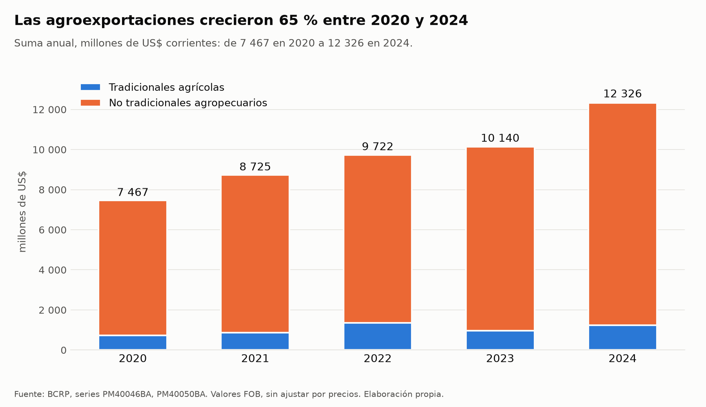
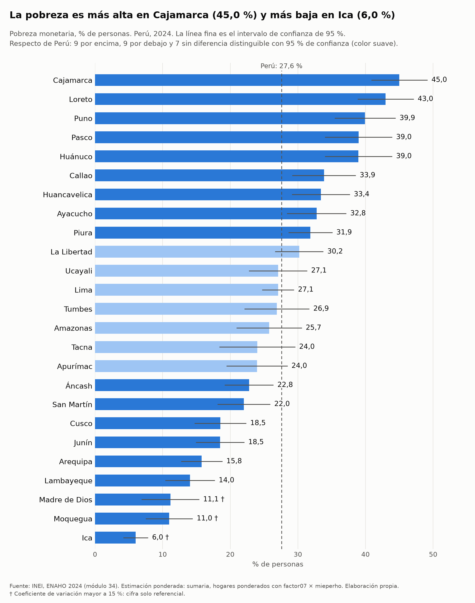
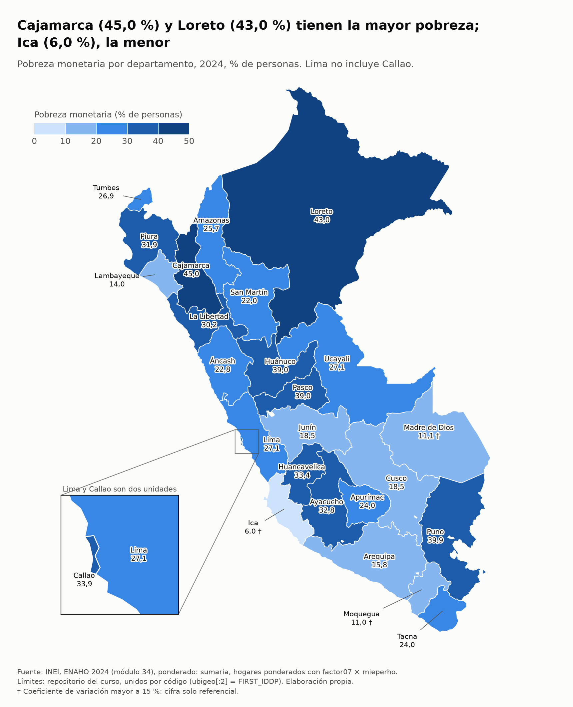
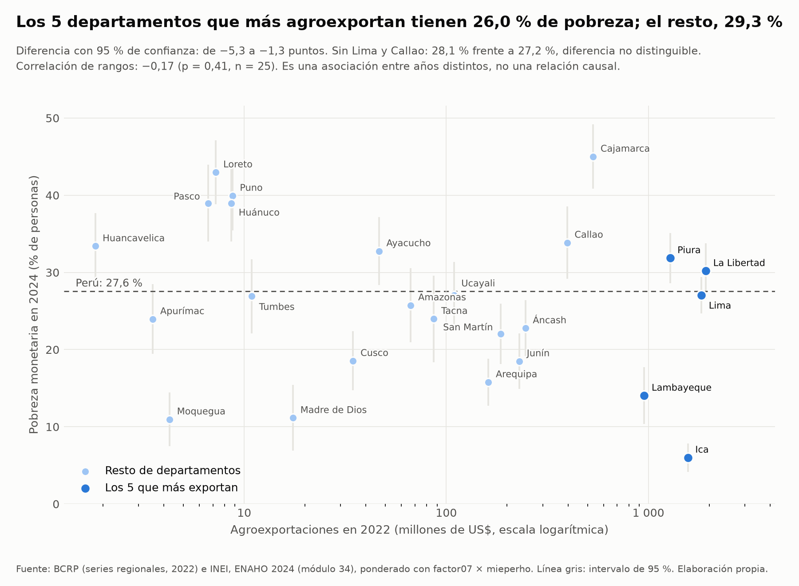

# Agroexportaciones peruanas 2020-2024 y pobreza monetaria departamental

## 1. Pregunta de investigación

**Tema.** Evolución de las agroexportaciones peruanas y su relación con la pobreza monetaria departamental.

**Pregunta.** ¿Cómo evolucionaron las agroexportaciones peruanas entre 2020 y 2024, y los departamentos que más agroexportaban en 2022 tenían menos pobreza monetaria en 2024?

**Objetivo.** (1) Describir la evolución anual 2020-2024 de las agroexportaciones nacionales. (2) Medir si los departamentos con más agroexportaciones en 2022 tenían menor pobreza monetaria en 2024.

**Delimitación.**
- Agroexportaciones = productos tradicionales agrícolas + productos no tradicionales agropecuarios, en valores FOB, millones de US$ corrientes. Quedan fuera las exportaciones de otros grupos (pesqueras, mineras, textiles, entre otras), y no se midió volumen.
- Pobreza monetaria: porcentaje de personas en hogares pobres, ENAHO 2024, 25 unidades territoriales con Lima y Callao separados.
- El cruce compara el año 2022 (exportaciones) con el año 2024 (pobreza). Es una asociación entre niveles de años distintos.

## 2. Fuentes y metodología

**BCRP (servidor MCP, serie anual, valores FOB en millones de US$).**
- Nacional: `PM40046BA` (productos tradicionales, agrícolas) y `PM40050BA` (productos no tradicionales, agropecuarios). Fuente original: BCRP, Sunat, empresas; publica el Departamento de Estadísticas de Balanza de Pagos. Datos desde 2012; consultados de 2020 a 2024 (5 datos por serie). Actualizadas el 19 de mayo de 2026.
- Departamental: 25 series de tradicionales agrícolas (`RD40960BA`, `RD40977BA`, `RD40994BA`, `RD41011BA`, `RD41028BA`, `RD41045BA`, `RD41062BA`, `RD41079BA`, `RD41096BA`, `RD41113BA`, `RD41130BA`, `RD41147BA`, `RD41164BA`, `RD41181BA`, `RD41198BA`, `RD41215BA`, `RD41232BA`, `RD41249BA`, `RD41266BA`, `RD41283BA`, `RD41300BA`, `RD41317BA`, `RD41334BA`, `RD41351BA`, `RD41368BA`) y 25 de no tradicionales agropecuarios (`RD40964BA`, `RD40981BA`, `RD40998BA`, `RD41015BA`, `RD41032BA`, `RD41049BA`, `RD41066BA`, `RD41083BA`, `RD41100BA`, `RD41117BA`, `RD41134BA`, `RD41151BA`, `RD41168BA`, `RD41185BA`, `RD41202BA`, `RD41219BA`, `RD41236BA`, `RD41253BA`, `RD41270BA`, `RD41287BA`, `RD41304BA`, `RD41321BA`, `RD41338BA`, `RD41355BA`, `RD41372BA`), más las dos series «sin ubigeo» (`RD41385BA`, `RD41389BA`). Datos desde 2005, actualizadas el 20 de diciembre de 2024; **terminan en 2022**.

**ENAHO 2024 (INEI), módulos 34 y 02.** La Skill `limpiando-enaho` unió sumaria y miembros, y la validación quedó **APROBADA** (25 comprobaciones aprobadas, 0 fallidas). Pobreza nacional: 27,58 % (referencia INEI 27,6 %). Las cifras departamentales usan la base de hogares ponderada (`factor07 × mieperho`), con intervalos de 95 %. Las Skills `graficando-enaho` y `mapeando-enaho` generaron el gráfico y el mapa; la validación del mapa quedó APROBADA (25 de 25 unidades; diferencia máxima de 0,05 pp frente a la referencia de la Sesión 16, en Amazonas).

**Procesamiento del cruce.** `graficar_bcrp.py` suma por año las dos series nacionales. `cruzar.py` suma por departamento las dos series de 2022, ordena los departamentos, compara a los 5 primeros con el resto (diferencia con intervalo de 95 %), calcula la correlación de rangos de Spearman con prueba de permutaciones y repite el cruce sin Lima y Callao y por grupo de producto.

## 3. Resultados

1. **Las agroexportaciones crecieron 65,08 % entre 2020 y 2024.** La suma de ambas series pasó de 7 466,5 millones de US$ (2020) a 12 325,6 millones de US$ (2024) (`salidas/agroexportaciones_anual.csv`). Cifras de valor FOB en dólares corrientes: no equivalen a crecimiento de volumen.
2. **Los dos componentes tuvieron trayectorias distintas.** Los no tradicionales agropecuarios (`PM40050BA`) subieron cada año, de 6 735,4 a 11 096,2 millones de US$ (+64,74 %), con máximo en 2024. Los tradicionales agrícolas (`PM40046BA`) pasaron de 731,1 a 1 229,4 millones de US$ (+68,15 %), pero con máximo en 2022 (1 354,2) y caída en 2023 (970,7).
3. **En 2022 la agroexportación estaba muy concentrada.** Los cinco primeros departamentos (La Libertad, Lima, Ica, Piura y Lambayeque) reunieron 77,72 % del total departamental de 9 721,9 millones de US$. La Libertad (1 924,3) y Lima (1 829,5) encabezaron. La suma de los 25 departamentos coincide con el total nacional (9 721,88 frente a 9 721,92; diferencia −0,0004 %), y la serie «sin ubigeo» no aportó monto en 2022.
4. **Resultado principal del cruce, no firme:** los 5 departamentos que más agroexportaron en 2022 tenían 26,0 % de pobreza en 2024 (IC 95 %: 24,3 a 27,6; personas) y el resto 29,3 % (IC 95 %: 28,2 a 30,3), con una diferencia de −3,3 puntos (IC 95 %: −5,3 a −1,3), que se distingue del error de muestreo.
5. **Esa diferencia no resiste las pruebas de sensibilidad:**
   - **Sin Lima y Callao**, el grupo de los 5 primeros cambia (entra Cajamarca, con 45,0 % de pobreza) y la pobreza es 28,1 % frente a 27,2 % en el resto: diferencia de +1,0 punto (IC 95 %: −1,1 a +3,0), **no distinguible** del error de muestreo y de signo contrario.
   - **Correlación de rangos** entre agroexportaciones y pobreza: −0,17 (p = 0,41; n = 25); por habitante, −0,28 (p = 0,18); sin Lima y Callao, −0,26 (p = 0,24; n = 23). Ninguna es estadísticamente distinguible de cero.
   - **Solo tradicionales agrícolas**: rho = +0,17 (p = 0,41); los 5 primeros (Cajamarca, Lima, Callao, Junín, Lambayeque) difieren del resto en −0,3 puntos (IC 95 %: −2,3 a +1,7), no distinguible. **Solo no tradicionales**: rho = −0,26 (p = 0,22); diferencia de −3,3 puntos (distinguible) y de −5,7 puntos sin Lima y Callao (distinguible).
6. **Entre los mayores agroexportadores la pobreza es muy heterogénea.** Ica tiene 6,0 % (†) y Lambayeque 14,0 %, pero Piura 31,9 %, La Libertad 30,2 % y Lima 27,1 %. Cajamarca (45,0 %, la más alta del país) es sexta en agroexportaciones (532,9 millones de US$).

† Coeficiente de variación mayor a 15 %: cifra solo referencial (Ica 15,6 %, Moquegua 16,2 %, Madre de Dios 19,5 %). Las demás cifras departamentales de pobreza citadas tienen CV de 15 % o menos.

## 4. Visualizaciones









## 5. Interpretación

- A escala nacional, las agroexportaciones crecieron de forma sostenida en valor, impulsadas sobre todo por los no tradicionales, mientras los tradicionales fluctuaron.
- El cruce con la pobreza **no permite afirmar** que los departamentos más agroexportadores tuvieran menos pobreza. El gráfico muestra una diferencia de 3,3 puntos entre los 5 primeros y el resto, pero desaparece (y cambia de signo) al excluir Lima y Callao, y la correlación de rangos es débil y no distinguible de cero en todas las variantes. La asociación aparece solo en los no tradicionales y depende de la definición de agroexportación.
- Los datos muestran dos polos: Ica y Lambayeque combinan alta agroexportación y baja pobreza, mientras Piura y La Libertad combinan alta agroexportación y pobreza por encima del promedio nacional (27,6 %), aunque La Libertad no se distingue de ese promedio con 95 % de confianza. Cajamarca, el más pobre, también está entre los diez mayores agroexportadores.
- Son asociaciones entre un año (2022) y otro (2024), medidas sobre 25 unidades, y no sostienen una relación causal en ningún sentido.

## 6. Limitaciones

- **Cobertura temporal.** Las series departamentales cubren de 2005 a 2022 (en la consulta, 2020-2022). No existe desglose departamental para 2023 y 2024; por eso el cruce usa 2022 y no puede mostrar cómo cambió la distribución territorial después. La pobreza solo cubre 2024: no hay serie ENAHO para comparar cambios en el tiempo.
- **Años distintos.** Exportaciones 2022 frente a pobreza 2024; la pobreza de 2022 no se consultó.
- **Incógnita metodológica.** Las fichas de las series (`metodologia: null`) no dicen cómo asigna el BCRP cada exportación a un departamento (por ejemplo, si Lima y Callao reflejan domicilio fiscal o puerto de salida). Esto es relevante porque ambos concentran valor y la conclusión cambia al excluirlos.
- **Dólares corrientes y valor FOB.** No se separó precio de volumen, ni se deflactó.
- **Definición de agroexportación.** Solo incluye los dos grupos nombrados; queda fuera cualquier producto de origen agrario clasificado en otro grupo. Los resultados cambian según el grupo usado.
- **Calidad muestral.** Con 25 unidades y estimaciones muestrales de pobreza, los órdenes entre departamentos con intervalos cruzados no son seguros. Ica, Moquegua y Madre de Dios tienen CV mayor a 15 %; Ica pertenece al grupo de los 5 primeros.
- **Pruebas.** El p-valor de Spearman es por permutaciones sobre 25 puntos y no corrige por autocorrelación espacial.
- **Alcance.** La pobreza es de personas en hogares pobres; las agroexportaciones se atribuyen a cada departamento con un criterio que las fichas no explican, y no miden el empleo ni los ingresos de los hogares del departamento.
- **Búsqueda.** Dos series nacionales adicionales (`PM40076BA`, `PM40121BA`) repiten valores idénticos de `PM40046BA` y `PM40050BA`; se excluyeron para no duplicar la suma.

## 7. Reproducibilidad

**Herramientas y Skills.** MCP del BCRP: `buscar_series`, recurso `bcrp://serie/{codigo}`, `resumen`, `guardar_series`. Skills: `limpiando-enaho`, `graficando-enaho`, `mapeando-enaho`, `investigando-peru`.

**Comandos (desde `tarea_4/`).**

```bash
uv run .claude/skills/limpiando-enaho/scripts/limpiar.py
uv run .claude/skills/graficando-enaho/scripts/graficar.py --por departamento
uv run .claude/skills/mapeando-enaho/scripts/mapear.py
uv run .claude/skills/investigando-peru/scripts/graficar_bcrp.py --datos salidas/bcrp/agro_nacional.csv --desde 2020 --hasta 2024 --tema agroexportaciones --unidad "millones de US$" --etiqueta PM40046BA="Tradicionales agrícolas" --etiqueta PM40050BA="No tradicionales agropecuarios"
uv run .claude/skills/investigando-peru/scripts/cruzar.py --datos salidas/bcrp/agro_departamental.csv --nacional salidas/agroexportaciones_anual.csv --anio 2022 --tema agroexportaciones --unidad "millones de US$"
```

**Archivos.** `salidas/bcrp/agro_nacional.csv` (`guardar_series`, 2 series, 2020-2024), `salidas/bcrp/agro_departamental.csv` (52 series, 2020-2022), `salidas/agroexportaciones_anual.csv`, `salidas/cruce_agroexportaciones.csv` y `.json`, `salidas/validacion.txt`, `salidas/validacion_mapa.txt`, `salidas/comparacion_mapa.csv`, `salidas/indicadores.csv`, `figuras/agroexportaciones_bcrp.png`, `figuras/pobreza_departamento.png`, `figuras/cruce_agroexportaciones.png`, `mapas/pobreza_departamento.png`, `informes/plan.md`.

**Origen de las cifras**

| Afirmación | Cifra | Archivo o serie |
|---|---|---|
| Agroexportaciones totales 2020 | 7 466,5 millones de US$ | `salidas/agroexportaciones_anual.csv` (PM40046BA + PM40050BA) |
| Agroexportaciones totales 2024 | 12 325,6 millones de US$ | `salidas/agroexportaciones_anual.csv` |
| Variación del total 2020-2024 | +65,08 % | salida de `graficar_bcrp.py` |
| No tradicionales agropecuarios 2020 y 2024 | 6 735,4 y 11 096,2 millones de US$; +64,74 % | PM40050BA; `resumen` |
| Tradicionales agrícolas 2020, 2022, 2023 y 2024 | 731,1; 1 354,2; 970,7 y 1 229,4 millones de US$; +68,15 % | PM40046BA; `resumen` |
| Participación de los 5 primeros en 2022 | 77,72 % | `salidas/cruce_agroexportaciones.json` |
| Agroexportaciones 2022 de La Libertad, Lima y Cajamarca | 1 924,3; 1 829,5 y 532,9 millones de US$ | `salidas/cruce_agroexportaciones.csv` |
| Suma departamental frente a total nacional 2022 | 9 721,88 frente a 9 721,92; −0,0004 % | `cruce_agroexportaciones.json` (`contraste_con_total_nacional`) |
| Pobreza de los 5 primeros y del resto | 26,0 % y 29,3 %; diferencia −3,3 (IC −5,3 a −1,3) | `cruce_agroexportaciones.json` (`comparacion_primeros`) |
| Sin Lima y Callao | 28,1 % y 27,2 %; diferencia +1,0 (IC −1,1 a +3,0) | `cruce_agroexportaciones.json` (`comparacion_sin_lima_callao`) |
| Correlaciones de rangos | −0,17 (p 0,41); −0,28 (p 0,18); −0,26 (p 0,24) | `cruce_agroexportaciones.json` |
| Sensibilidad por producto | tradicionales +0,17 (p 0,41); no tradicionales −0,26 (p 0,22) | `cruce_agroexportaciones.json` (`sensibilidad_por_producto`) |
| Pobreza por departamento (Ica, Lambayeque, Piura, La Libertad, Lima, Cajamarca) | 6,0; 14,0; 31,9; 30,2; 27,1 y 45,0 % | `salidas/cruce_agroexportaciones.csv`; salida de `graficar.py` |
| CV mayor a 15 % | Ica 15,6; Moquegua 16,2; Madre de Dios 19,5 % | `salidas/cruce_agroexportaciones.csv` |
| Pobreza nacional 2024 | 27,58 % (hogares, `factor07 × mieperho`) | `salidas/validacion.txt` |
| Validación del mapa | 25 de 25 unidades; diferencia máxima 0,05 pp (Amazonas) | `salidas/validacion_mapa.txt` |
